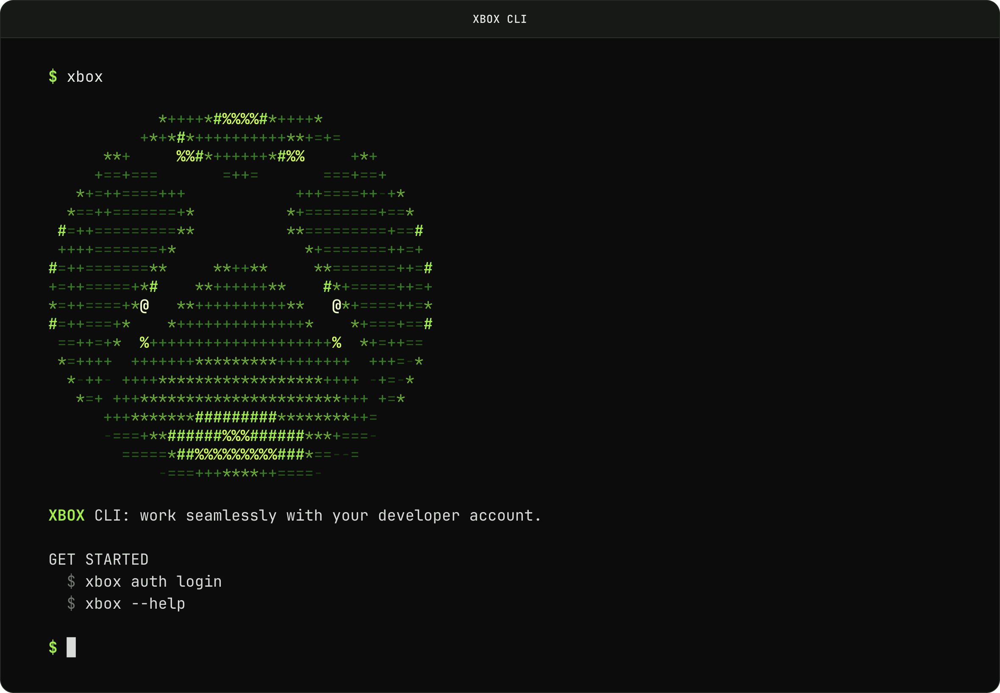

<h1 align="center">XBOX CLI</h1>

<p align="center">
  Build, release, and operate XBOX games from your terminal, scripts, and AI agents.
</p>

<p align="center">
  
</p>

## Quickstart

Install with WinGet on Windows:

```powershell
winget install Microsoft.Gaming.XBOXDeveloperCLI
```

Run the install script on macOS or Linux:

```bash
curl -fsSL https://raw.githubusercontent.com/xbox/cli/main/install.sh | sh
```

No .NET installation is required. To install from an archive instead, see
[Installation](docs/installation.md).

Sign in, which opens your browser, then list your Partner Center sellers, save the one
you work with, and list its games:

```bash
xbox auth login
xbox seller list --output table
xbox context set seller-id 1234567
xbox game list --output table
```

[Getting started](docs/getting-started.md) explains each step. To work with a
PlayFab title, follow the [PlayFab quick start](docs/playfab-api.md#setup); your
account needs **Admin** permission on the title.

## What you can do

Each row is a starting point. Run `xbox help <command>` for its options, or follow the link.

| Task | Command | Learn more |
| --- | --- | --- |
| Find your games, with their Store IDs and XBOX title IDs | `xbox game list` | [Games](docs/commands/game.md) |
| Create and manage XBOX sandboxes | `xbox sandbox list` | [Sandboxes](docs/commands/sandbox.md) |
| Manage test account batches | `xbox test-account batch list` | [Test accounts](docs/commands/test-account.md) |
| Review and publish playtests | `xbox playtest list` | [Playtests](docs/commands/playtest.md) |
| Check or switch a PC's XBOX sandbox | `xbox pc sandbox get` | [PC](docs/commands/pc.md) |
| Download, validate, and publish XBOX services configuration | `xbox xbl config download` | [XBOX services](docs/commands/xbl.md) |
| Read and change PlayFab title data | `xbox playfab title-data get` | [Title data](docs/commands/playfab/title-data.md) |
| Manage multiplayer servers | `xbox playfab mps build list` | [Multiplayer Servers](docs/commands/playfab/mps.md) |
| Call a title-level PlayFab API | `xbox playfab api /Admin/GetTitleData` | [PlayFab API](docs/playfab-api.md) |

> [!NOTE]
> The XBOX CLI is a technical preview, so commands and output can change between
> releases. Report problems and ideas in [GitHub Issues](https://github.com/xbox/cli/issues), or run
> `xbox feedback`.

## Documentation

Start at the [documentation index](docs/README.md), or run `xbox --help`. The
[command reference](docs/commands.md) covers every command, and
[Configuration](docs/configuration.md) covers settings and environment variables.

## AI agents

Add this to your agent's instructions, such as `AGENTS.md`:

```markdown
Before running the `xbox` CLI, read and follow
https://github.com/xbox/cli/blob/main/docs/cli-for-agents.md
```

## Support and security

The XBOX CLI is a technical preview, supported through [GitHub Issues](https://github.com/xbox/cli/issues),
not Microsoft Customer Service & Support. See [SUPPORT.md](SUPPORT.md) for the full
policy. Report security vulnerabilities as described in [SECURITY.md](SECURITY.md), not
through public issues.

## Contributing

Contributions go through [GitHub Issues](https://github.com/xbox/cli/issues); this repository doesn't
accept pull requests yet. See [CONTRIBUTING.md](CONTRIBUTING.md) for development guidance.
This project has adopted the [Microsoft Open Source Code of Conduct](https://opensource.microsoft.com/codeofconduct/);
see [CODE_OF_CONDUCT.md](CODE_OF_CONDUCT.md).

## Data collection

Official releases send limited, anonymous usage and reliability telemetry to Microsoft.
They never collect command arguments, PlayFab payloads, title IDs, identities, tokens, or
local paths. To opt out, set `XBOX_TELEMETRY_OPTOUT=1` or pass `--disable-telemetry`.
See [Telemetry](docs/telemetry.md), the
[Microsoft privacy statement](https://go.microsoft.com/fwlink/?LinkID=824704), and
[PRIVACY.md](PRIVACY.md).

## Trademarks

This project may contain trademarks or logos for projects, products, or services. Authorized use of Microsoft trademarks or logos is subject to and must follow [Microsoft's Trademark & Brand Guidelines](https://www.microsoft.com/en-us/legal/intellectualproperty/trademarks/usage/general). Use of Microsoft trademarks or logos in modified versions of this project must not cause confusion or imply Microsoft sponsorship. Any use of third-party trademarks or logos is subject to those third parties' policies.

## License

Licensed under the MIT License — see [LICENSE](LICENSE).
